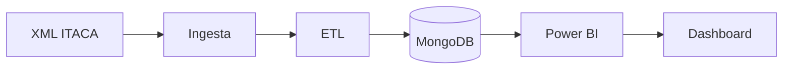
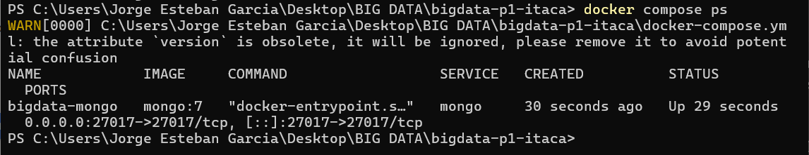

# Proyecto 1 · ITACA

> Análisis de datos académicos a partir de ficheros XML exportados de ITACA, con MongoDB y Power BI.

## Descripción y objetivo

Proyecto de **ingesta, procesamiento y análisis de datos académicos** a partir de ficheros XML exportados de la plataforma **ITACA**.

El flujo de datos comprende la extracción de información sobre **alumnado, cursos, módulos y calificaciones**, su transformación y modelado documental en **MongoDB**, y su posterior explotación mediante **Power BI** para la creación de un dashboard de análisis académico.

> [!NOTE]
> Los datos de alumnado deben estar siempre anonimizados.

## Arquitectura

*Diagrama provisional del Bloque 0. Se actualizará al terminar cada bloque.*


## Fuentes de datos

| Fuente | URL / origen | Formato | Frecuencia de actualización | Licencia | Última ingesta |
|---|---|---|---|---|---|
| Exportación de ITACA | Plataforma ITACA | XML | Pendiente | Pendiente | Pendiente |

## Estructura del repositorio

| Carpeta | Contenido |
|---|---|
| `ingesta/` | Captura y extracción de datos desde los ficheros XML exportados de ITACA |
| `etl/` | Transformación, limpieza y carga de los datos en MongoDB |
| `dashboard/` | Visualización y análisis de los datos mediante Power BI |
| `docker-compose.yml` | Definición del servicio MongoDB |

## Cómo desplegar el entorno

**Requisitos:** Docker Desktop (con Docker Compose) y Git.

1. Clona el repositorio:

```bash
git clone https://github.com/jorgeestebandam/bigdata-p1-itaca.git
cd bigdata-p1-itaca
```

2. Levanta los servicios en segundo plano:

```bash
docker compose up -d
```

3. Comprueba que MongoDB está en marcha:

```bash
docker compose ps
```

Debe aparecer el contenedor `bigdata-mongo` con estado `Up` y el puerto `27017`.

**Acceso a MongoDB**

- Host: `localhost`
- Puerto: `27017`
- Cadena de conexión: `mongodb://localhost:27017`

**Detener los servicios**

```bash
docker compose down
```

> [!WARNING]
> `docker compose down -v` elimina también el volumen `mongo-data` y, con él, todos los datos.

## Bitácora de prácticas

### Bloque 0 · Entorno

**Objetivo:** dejar preparado el entorno base del proyecto: repositorio Git independiente, estructura de carpetas, `.gitignore`, `docker-compose.yml` con MongoDB y README inicial.

**Pasos realizados:**

1. Creación del repositorio con `git init` y la rama `main`.
2. Creación de las carpetas `ingesta/`, `etl/` y `dashboard/` (con `.gitkeep` para que Git las conserve).
3. Configuración del `.gitignore`.
4. Creación del `docker-compose.yml` con el servicio MongoDB 7 (volumen persistente y red `bigdata-net`).
5. Arranque con `docker compose up -d` y comprobación con `docker compose ps`.
6. Primer commit y publicación en GitHub.

**Problemas encontrados y solución:**

- **Error al conectar con la API de Docker:** Docker Desktop no estaba en marcha. Se solucionó abriéndolo y esperando a que el motor estuviera activo antes de ejecutar `docker compose up -d`.
- **`README.html` incluido en el commit:** un archivo HTML generado a partir del README se coló en `git add .`. Se retiró con `git rm --cached README.html` y se añadió al `.gitignore`.
- **Aviso de `version` obsoleto en el compose:** es solo informativo, el atributo se ignora en las versiones recientes de Docker Compose.

**Resultado:** contenedor `bigdata-mongo` en ejecución.



## Decisiones técnicas

| Decisión | Alternativa descartada | Motivo |
|---|---|---|
| MongoDB como almacenamiento | Base de datos relacional | Los XML de ITACA tienen estructura anidada, que encaja de forma natural en documentos |
| Docker Compose para el entorno | Instalación local de MongoDB | Entorno reproducible y aislado, sin instalar nada en el equipo |

## Equipo

- Jorge Esteban García
