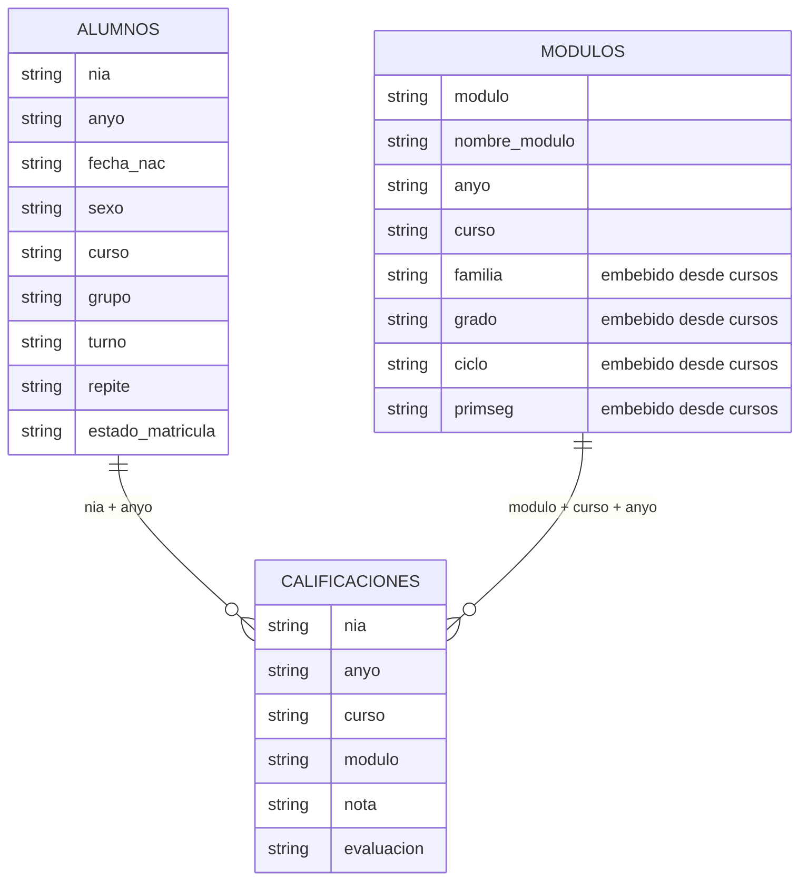
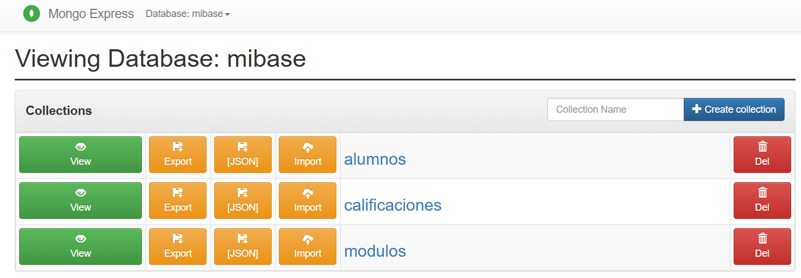
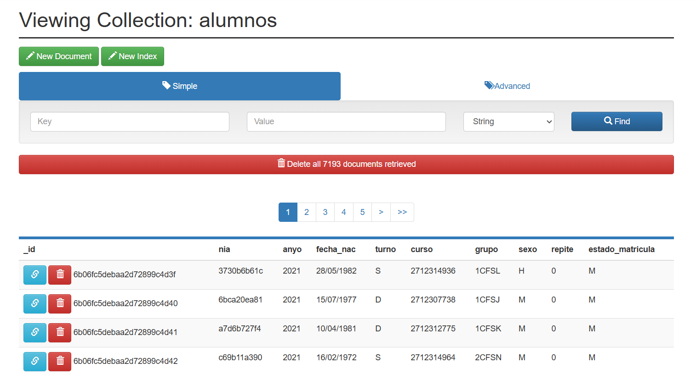
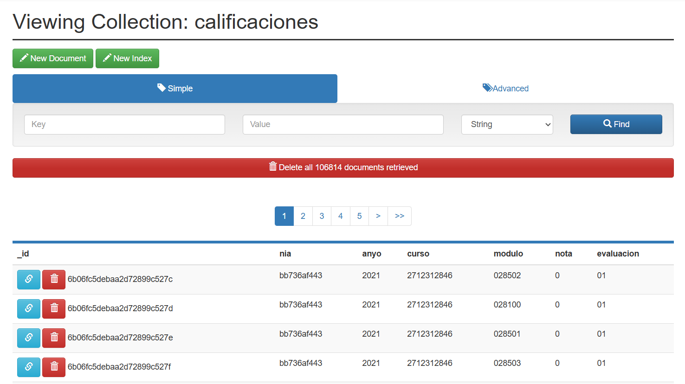
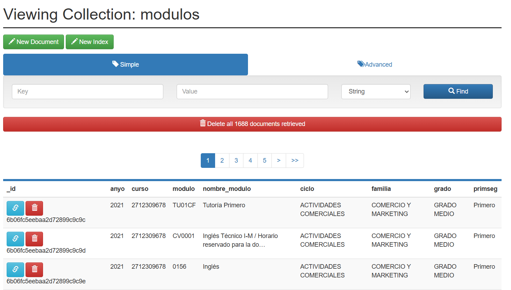

# Bloque 2 · Modelo documental y carga en MongoDB

## Modelo documental

La base de datos queda con **tres colecciones**: `alumnos`, `calificaciones` y `modulos`. La colección `cursos` solo existe durante la carga: sirve para resolver la jerarquía de cursos y se elimina al terminar.



### Ejemplo de documento por colección

```json
// alumnos
{ "nia": "3730b6b61c", "anyo": "2021", "fecha_nac": "28/05/1982", "turno": "S",
  "curso": "2712314936", "grupo": "1CFSL", "sexo": "H", "repite": "0", "estado_matricula": "M" }

// calificaciones
{ "nia": "3730b6b61c", "anyo": "2021", "curso": "2712314936",
  "modulo": "…", "nota": "…", "evaluacion": "…" }

// modulos
{ "modulo": "…", "nombre_modulo": "…", "anyo": "2021", "curso": "2712314936",
  "familia": "…", "grado": "…", "ciclo": "…", "primseg": "Primero" }
```

## Decisiones de embebido vs referencia

| Relación | Decisión | Motivo |
|---|---|---|
| `cursos` → `modulos` (familia, grado, ciclo, primero/segundo) | **Embebido** (desnormalizado) | En ITACA los cursos forman un árbol (`padre`) de varios niveles. Se aplana con `$lookup` encadenados y se copian `familia`, `grado`, `ciclo` y `primseg` en cada módulo. Son datos pequeños, que no cambian dentro de un curso académico y que se consultan siempre junto al módulo, así que se evita hacer joins en Power BI. Después se elimina la colección `cursos`. |
| `alumnos` ↔ `calificaciones` | **Referencia** (`nia` + `anyo`) | Cada alumno tiene muchas calificaciones (varios módulos × varias evaluaciones × varios años). Si se embebieran, el documento del alumno crecería sin límite y se acercaría al máximo de 16 MB. Además, las calificaciones se analizan de forma independiente (por curso, módulo o evaluación). |
| `modulos` ↔ `calificaciones` | **Referencia** (`modulo` + `curso` + `anyo`) | Un módulo es compartido por todos los alumnos del curso. Si se embebiera en cada calificación, su nombre y su jerarquía se repetirían miles de veces. |
| Alumno por curso académico | **Un documento por `nia` + `anyo`** | La matrícula (curso, grupo, turno, repite, estado) cambia de un año a otro, así que se guarda una foto por año en vez de un único documento con un historial. |

### Otras decisiones

- **Renombrado y selección de campos**: solo se cargan los campos necesarios para el análisis y se normalizan sus nombres (`NIA` → `nia`, `contenido` → `modulo`, `nota_numerica` → `nota`, `nombre_cas` → `nombre_modulo`).
- **Recarga completa**: antes de cargar se borran las colecciones (`limpiar_bd`), así el script se puede ejecutar varias veces sin duplicar datos.
- **Índices** pensados para las consultas del dashboard:

| Colección | Índice |
|---|---|
| `calificaciones` | `{curso, anyo, evaluacion}`, `{nia}` |
| `alumnos` | `{nia, anyo}`, `{curso, anyo}` |
| `modulos` | `{modulo, anyo, curso}` (único) |

## Ejecución de la carga

Con los servicios levantados (`docker compose up -d`) y el `.env` configurado (`MONGO_PASSWORD`, `DB_NAME`):

```bash
python etl/scripts/cargar_mongodb.py
```

El script recorre `ingesta/data/raw/<año>/` (2021 a 2025) y, para cada año, carga `alumnos`, `calificaciones`, `cursos` y `contenidos` (que se convierte en `modulos`).

## Capturas de Mongo Express


### Colecciones de la base de datos



### Colección `alumnos`



### Colección `calificaciones`



### Colección `modulos`


